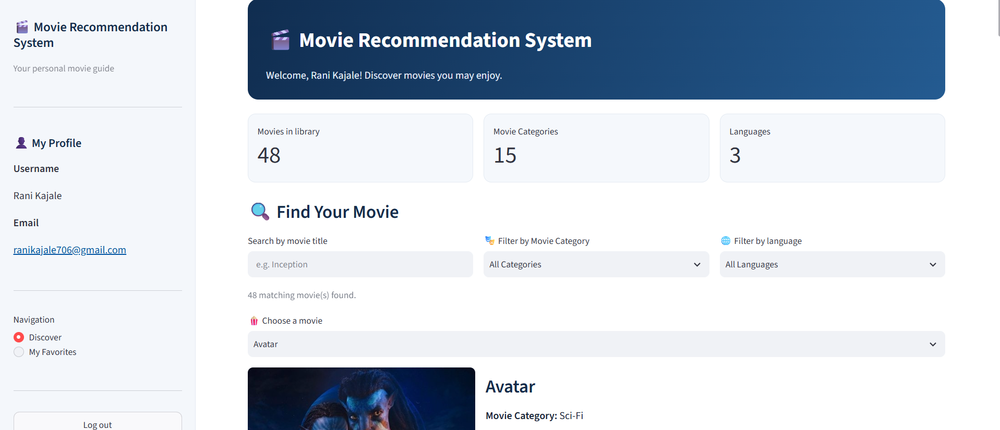
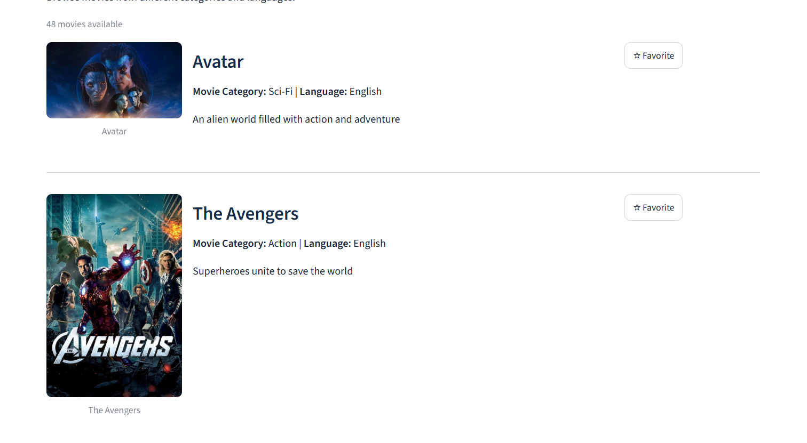
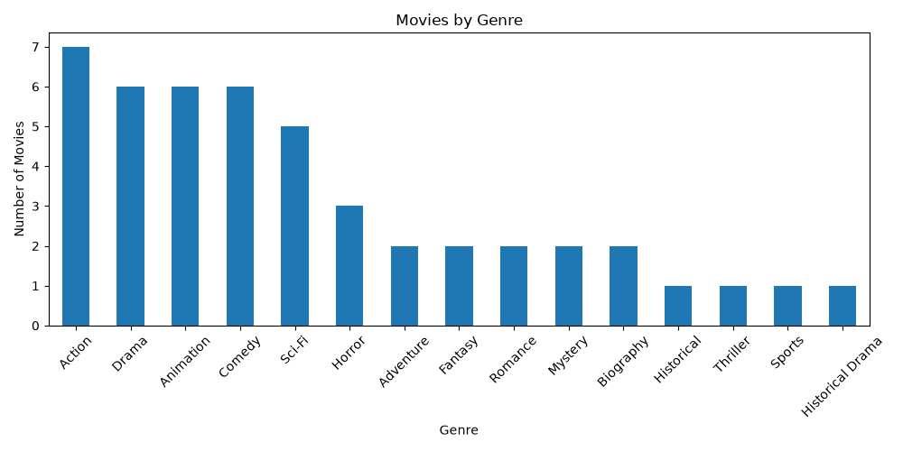
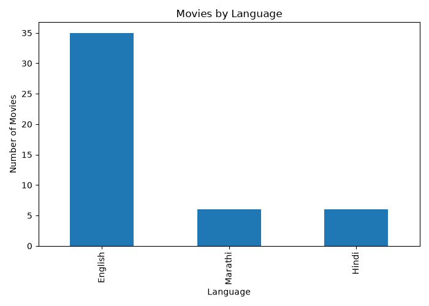
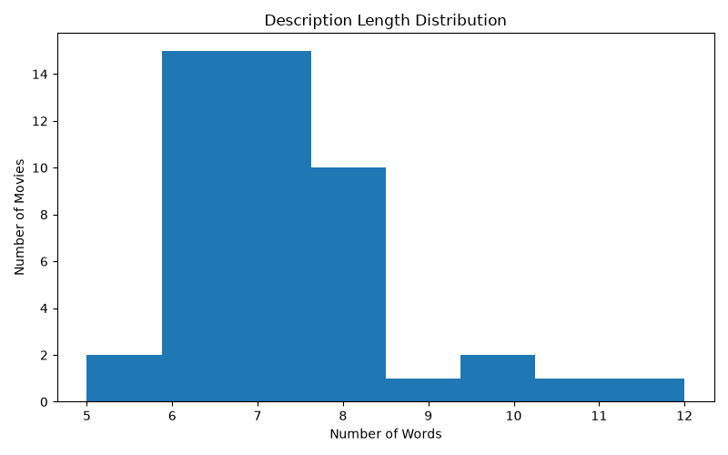

# 🎬 Movie Recommendation System

A Machine Learning-based Movie Recommendation System developed using **Python, Scikit-learn, Pandas, and Streamlit**. This project uses **Content-Based Filtering** to recommend movies based on their genre and description.

The system helps users discover movies similar to their selected movie. It provides an interactive interface where users can explore movies, apply genre and language filters, receive recommendations, create accounts, log in, and manage their favourite movies.

---

## 1. Aim

The main aim of this project is to design and develop a Machine Learning-based Movie Recommendation System that recommends movies according to their content.

The system analyzes movie genres and descriptions, converts textual information into numerical representations, and calculates similarity between movies using Cosine Similarity.

The application provides an easy-to-use interface through which users can discover movies and receive relevant recommendations.

---

## 2. Objectives

The main objectives of the Movie Recommendation System are:

1. To develop a movie recommendation system using Machine Learning techniques.
2. To implement Content-Based Filtering for recommending similar movies.
3. To collect and organize movie information in a structured dataset.
4. To perform data preprocessing and cleaning.
5. To select relevant features such as genre and description.
6. To convert textual movie information into numerical vectors.
7. To calculate similarity between movies using Cosine Similarity.
8. To implement and compare CountVectorizer and TF-IDF vectorization techniques.
9. To perform Exploratory Data Analysis (EDA) using graphical visualizations.
10. To evaluate different model configurations and select a suitable final model.
11. To develop an interactive frontend using Streamlit.
12. To provide movie filtering based on genre and language.
13. To implement user registration, login, and favourite movie management.

---

## 3. Problem Statement

Nowadays, a large number of movies are available in different genres and languages. Users often face difficulty selecting a movie because they may not know which movies are similar to their interests.

Searching manually through a large collection of movies can be time-consuming.

To solve this problem, this project proposes a Machine Learning-based Movie Recommendation System that recommends movies based on their content.

The system analyzes movie genres and descriptions and identifies movies having similar textual features. It uses CountVectorizer to convert text into numerical vectors and Cosine Similarity to measure similarity between movies.

The application displays recommended movies through an interactive Streamlit interface.

### Input

- A movie selected by the user.
- Movie genre and description information from the dataset.

### Output

- A list of recommended movies.
- Similarity scores for recommended movies.
- Movie titles and posters.

### Machine Learning Task

Content-Based Recommendation using text feature extraction and similarity measurement.

---

## 4. Dataset Information

The project uses a custom-curated movie dataset containing information about different movies.

The dataset contains **48 movie records** with six attributes.

### Dataset Description

### Dataset Description

| Attribute | Description |
|---|---|
| movie_id | Unique identification number of the movie |
| Title | Name of the movie |
| Genre | Category or type of movie |
| Description | Short description or storyline of the movie |
| Poster | Movie poster reference |
| Language | Language of the movie |

### Dataset Features

- Total movie records: 48
- Total attributes: 6
- Movie languages: English, Hindi, and Marathi
- Data format: CSV
- Dataset file: `movies.csv`

### Feature Usage

The dataset contains several attributes, but the recommendation model uses only the following content features:

- **Genre:** Represents the category of the movie.
- **Description:** Represents the storyline and textual information of the movie.

Other attributes are used by the application:

- Title is used for movie identification and selection.
- Language is used for frontend filtering.
- Poster is used for displaying movie images.

The language and poster attributes are not included in the model's text vectorization.

---

## 5. ML Pipeline

The Machine Learning pipeline describes the complete process followed to develop the Movie Recommendation System.

### Step 1: Data Collection

A custom-curated movie dataset containing 47 records was prepared in CSV format.

### Step 2: Data Preprocessing

The dataset was prepared for analysis and model development.

The preprocessing operations include:

- Removing duplicate records.
- Handling missing text values.
- Removing unnecessary whitespace.
- Cleaning the dataset for further processing.

**Purpose:** To maintain consistent data and prepare the textual information for feature extraction.

### Step 3: Exploratory Data Analysis

EDA was performed to understand the structure and distribution of the dataset.

The following visualizations were generated:

- Genre distribution.
- Language distribution.
- Description length distribution.

Matplotlib was used to generate the graphical representations.

### Step 4: Feature Selection

Relevant features were selected for the recommendation model.

The selected features are:

1. Genre
2. Description

Both features are combined to create a content feature used by the recommendation model.

### Step 5: Feature Extraction

The selected textual content is converted into numerical vectors using CountVectorizer.

An alternative TF-IDF vectorization technique was also implemented for comparison.

### Step 6: Train-Test Split

The dataset was divided into training and testing subsets using an 80:20 ratio.

- Training records: 37
- Testing records: 10
- Random state: 42

### Step 7: Model Comparison

CountVectorizer and TF-IDF were compared using project-defined diagnostic measures.

### Step 8: Similarity Calculation

Cosine Similarity was used to calculate similarity between movie-content vectors.

### Step 9: Model Improvement

Different CountVectorizer configurations were experimented with to observe their effect on similarity, genre match, and coverage.

### Step 10: Final Model

The selected CountVectorizer model was trained using the complete dataset of 47 records and saved using Joblib.

### Step 11: Recommendation Output

The Streamlit application loads the saved model and displays movies with similar content.

### ML Pipeline Diagram

```text
             Movie Dataset
                   |
                   v
           Data Preprocessing
                   |
                   v
        Exploratory Data Analysis
                   |
                   v
            Feature Selection
                   |
                   v
          Genre + Description
                   |
                   v
            CountVectorizer
                   |
                   v
          Numerical Vectors
                   |
                   v
           Cosine Similarity
                   |
                   v
          Similarity Ranking
                   |
                   v
          Recommended Movies
                   |
                   v
           Streamlit Frontend
```

### System Architecture

```text
                  USER
                    |
                    v
           STREAMLIT APPLICATION
                    |
          +---------+----------+
          |                    |
          v                    v
     MOVIE DATASET        SQLITE DATABASE
          |                    |
          v                    v
    SAVED ML MODEL       USER ACCOUNTS
          |              AND FAVOURITES
          v
     COUNTVECTORIZER
          |
          v
    COSINE SIMILARITY
          |
          v
   RECOMMENDATION RESULTS
          |
          v
    DISPLAY MOVIE CARDS
```

### Feature Scaling / Normalization

The selected features are textual data rather than independent numerical measurement features. Therefore, a separate numerical scaling technique such as StandardScaler is not required.

Cosine Similarity compares the direction of the text vectors and is used to measure similarity between movie-content representations.

---

## 6. Algorithms Used

The project implements and compares two text vectorization approaches.

### A. CountVectorizer

CountVectorizer is a text feature extraction technique provided by Scikit-learn.

It converts textual information into numerical vectors based on the frequency of words in the documents.

In this project:

- Genre and description are combined.
- Text is converted into numerical vectors.
- These vectors are used for calculating movie similarity.

**Advantages:**

- Simple to implement.
- Suitable for text-based feature extraction.
- Provides numerical representations of movie descriptions.

### B. TF-IDF Vectorizer

TF-IDF stands for Term Frequency-Inverse Document Frequency.

It is another text feature extraction technique that assigns importance to words based on their frequency in a document and across the collection of documents.

It helps represent the importance of words in movie descriptions.

**Advantages:**

- Gives different importance to words.
- Reduces the influence of very common terms.
- Provides an alternative representation for comparison.

### C. Cosine Similarity

Cosine Similarity is used to measure the similarity between two numerical vectors.

It calculates the cosine of the angle between the vectors.

The similarity score is used to rank movies according to their content similarity.

**Role in the project:**

- Compares movie-content vectors.
- Calculates similarity scores.
- Helps identify movies with similar content.
- Supports recommendation ranking.

---

## 7. Experimental Results

Experiments were performed to compare different text vectorization techniques and improve recommendation performance.

### A. Train-Test Split

The dataset was divided into training and testing subsets.

| Dataset | Number of Records |
|---|---:|
| Total Records | 47 |
| Training Records | 37 |
| Testing Records | 10 |
| Split Ratio | 80:20 |
| Random State | 42 |

An 80:20 split was selected to use most of the available records for training while reserving a portion for testing.

### B. Model Comparison Results

CountVectorizer and TF-IDF were compared using the same movie-content features.

| Evaluation Measure | CountVectorizer | TF-IDF |
|---|---:|---:|
| Average Similarity | 0.3453 | 0.2923 |
| Genre Match | 56% | 52% |
| Coverage | 78.38% | 78.38% |

### Result Analysis

- CountVectorizer achieved a higher average similarity score.
- CountVectorizer achieved a higher genre-match percentage.
- Both methods achieved the same coverage.
- Based on these experimental results, CountVectorizer was selected as the final approach.

### C. Model Improvement Experiments

Different CountVectorizer configurations were tested to observe their effect on recommendation results.

| Experiment | Average Similarity | Genre Match | Coverage |
|---|---:|---:|---:|
| Default CountVectorizer | 0.3453 | 56% | 78.38% |
| Unigrams + Bigrams | 0.2679 | 56% | 78.38% |
| min_df = 2 | 0.5411 | 58% | 67.57% |

### Observation

The `min_df=2` configuration increased the average similarity and genre-match values but reduced coverage.

The default CountVectorizer configuration was selected because it provided a better balance between similarity results and coverage.

**Evaluation Note:** The above values are project-specific diagnostic measures. They are not conventional classification accuracy. The project does not use labelled user-preference data or ground-truth relevance labels to calculate recommendation accuracy.

---

## 8. Final Model

After comparing the implemented approaches and conducting improvement experiments, CountVectorizer was selected as the final text vectorization technique.

### Final Model Configuration

| Component | Selected Method |
|---|---|
| Recommendation Technique | Content-Based Filtering |
| Content Features | Genre + Description |
| Feature Extraction | CountVectorizer |
| Similarity Measurement | Cosine Similarity |
| Dataset Size | 47 Records |
| Model Saving | Joblib |

### Final Model Process

1. Movie genre and description are combined.
2. CountVectorizer converts the textual content into numerical vectors.
3. Cosine Similarity calculates similarity between movie vectors.
4. Similarity scores are used to rank movies.
5. The system returns the most similar movies.

### Saved Model

The trained model is saved in the following file:

`movie_recommender_model.joblib`

The Streamlit application loads the saved model to generate movie recommendations.

The model is prepared separately and loaded by the frontend application.

---

## 9. Front-end Details

The frontend of the Movie Recommendation System is developed using **Streamlit**.

Streamlit provides an interactive web interface that allows users to explore movies and receive recommendations.

### Frontend Features

**1. User Registration**

New users can create an account to access the application.

**2. User Login**

Registered users can log in to their accounts.

**3. User Profile**

The application provides a profile section for logged-in users.

**4. Discover Movies**

Users can explore the available movie collection.

**5. Genre Filtering**

Users can filter movies according to their preferred genre.

**6. Language Filtering**

Users can filter movies based on English, Hindi, and Marathi languages.

**7. Movie Recommendations**

Users can select a movie and receive recommendations based on content similarity.

**8. Movie Posters**

Movie posters are displayed along with movie information.

**9. My Favorites**

Users can add movies to their favourites list and view their saved favourites.

**10. Remove Favorites**

Users can remove previously saved movies from their favourites list.

### Database

SQLite is used to manage user accounts and favourite movies.

The database operations are implemented separately in `database.py`.

---

## 10. Screenshots

The following screenshots demonstrate the working of the Movie Recommendation System.

### A. Movie Application

This screenshot displays the main application interface, including movie discovery, navigation, filters, and user profile.



### B. Movie List

This screenshot displays the available movies with their titles and posters.



### C. Movie Recommendations

This screenshot demonstrates the recommendation results generated after selecting a movie.


### D. Genre Distribution



### E. Language Distribution



### F. Description Length Distribution



---

## 11. Installation and Execution Instructions

Follow the steps below to download and execute the project on your local system.

### Prerequisites

- Python 3.x
- Visual Studio Code (recommended)
- Internet connection for installing dependencies

### Step 1: Clone the GitHub Repository

Open PowerShell or the VS Code terminal and execute:

```bash
git clone https://github.com/ranikajale706-art/Movie-Recommendation-System.git
```

### Step 2: Navigate to the Project Folder

```bash
cd Movie-Recommendation-System
```

### Step 3: Install Required Libraries

Install all required dependencies using:

```bash
python -m pip install -r requirements.txt
```

### Step 4: Run the Streamlit Application

```bash
streamlit run app.py
```

### Step 5: Open the Application

After executing the command, Streamlit will provide a local address in the terminal.

Open the displayed address in a web browser to access the Movie Recommendation System.

---

## 12. GitHub Repository

The complete project source code, dataset, notebook, trained model, documentation, and screenshots are maintained in the GitHub repository.

**Repository Name:** Movie Recommendation System

**GitHub Link:**

https://github.com/ranikajale706-art/Movie-Recommendation-System

---

## 13. Project Summary

The Movie Recommendation System demonstrates the practical application of Machine Learning and Natural Language Processing concepts in movie discovery.

The project uses a custom-curated dataset containing 47 movie records. Data preprocessing and feature selection are performed to prepare movie information for recommendation.

CountVectorizer and TF-IDF are implemented and compared. Cosine Similarity is used to measure similarity between movies based on genre and description.

After conducting experiments, CountVectorizer is selected as the final text vectorization approach. The trained model is saved using Joblib and integrated with a Streamlit frontend.

The application provides movie discovery, genre and language filtering, movie recommendations, user registration, login, and favourite movie management.

This project demonstrates how machine learning techniques can be used to build an interactive content-based recommendation application.